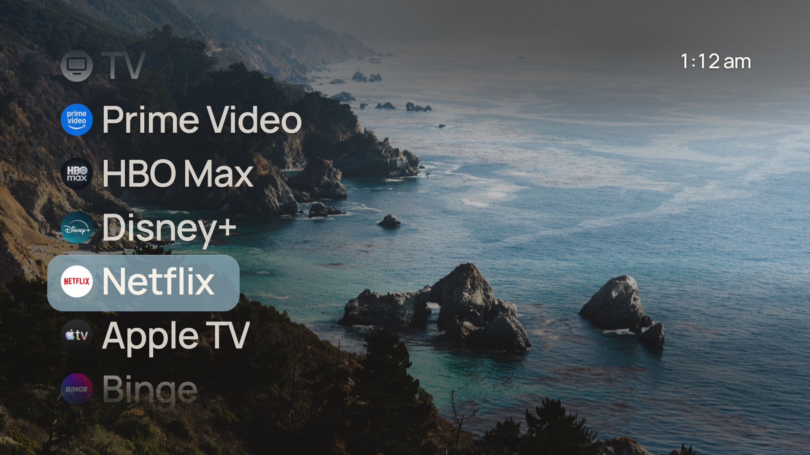
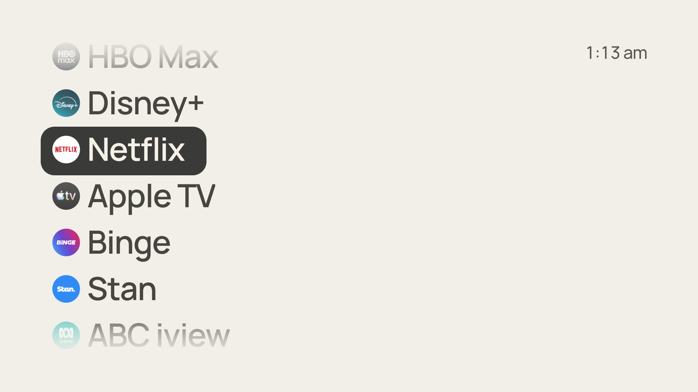
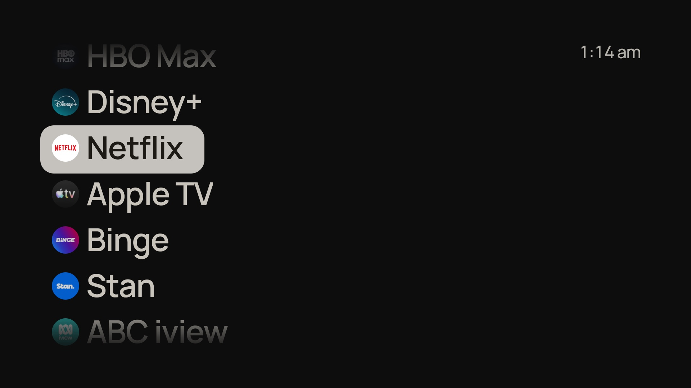
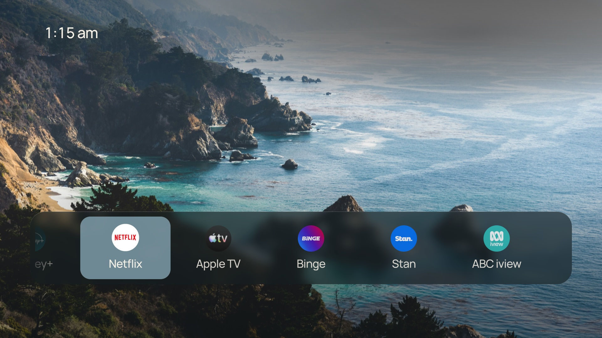

# DroidFrameTV

A quieter home screen for Android TV: your apps, a photograph and the time, built for the TV remote.



| White background | Black background | Dock layout |
| --- | --- | --- |
|  |  |  |

*Screenshots are from a Sony BRAVIA running Android TV, in the default List layout with Solid focus (From wallpaper, 20% transparency). The apps are whatever is installed on the TV. On the plain backgrounds the highlight inverts automatically.*

## Credit

DroidFrameTV is an Android TV port of **[CleanFrame](https://github.com/nthnclrk/CleanFrame) by [Nathan Clark](https://github.com/nthnclrk)**, which he built for Samsung The Frame. The interface, layouts, pre-rendered glass materials, remote navigation and the idea are his; this project keeps them as close to 1:1 as Android allows and replaces the Samsung/Tizen parts. Please star and credit the original.

The Android launcher shell borrows its approach from [qingyun7/CleanFrame-Android](https://github.com/qingyun7/CleanFrame-Android), an earlier independent Android port (MIT).

This is an independent project with no affiliation to Nathan Clark, Samsung, Google, Sony or any streaming service.

## AI notice

This project was developed with the assistance of **Claude Sonnet 5.5** (Anthropic), working as an AI coding assistant under the direction of the repository owner. Claude wrote and changed much of the Android code and the UI changes beyond the original CleanFrame, and prepared this documentation. Every change was tested on a real TV by the owner. The code is provided as is, under the licence below; review it before relying on it.

## What it does

- Home as a **List** (default) or a **Dock**, with icons, names or both, over a photograph, or a plain white or black background.
- **Solid focus**: the selection highlight is a plain colour you choose, including one computed from the wallpaper, with 0 to 100% transparency. Text colour follows automatically, and the colour inverts itself on the white and black backgrounds. Glass and Type focus from CleanFrame are still there.
- Shows each app's own launcher icon, cropped to a circle. Any number of apps on Home; add, remove and reorder them.
- Four fixed entries at the end of Home: **Play Store**, **Settings**, **Input** (the same picker as the remote's Input button) and **All apps**.
- **All apps** lists everything installed on the TV.
- The wallpaper changes each time the TV goes to sleep, so the new one is already there when it wakes (Settings > Background > Rotation).
- Optional location or photo credit shown at the bottom right (see [your own wallpapers](#your-own-wallpapers)).
- Runs offline. No network, storage or accessibility permissions.

Differences from the original: no Art Mode, Back on Home stays on Home, the clock shows am or pm, and the Samsung-only entries are replaced with Android's.

## Install

Download `DroidFrameTV.apk` from [Releases](../../releases), then with the TV's network debugging on:

```sh
adb connect <tv-ip>:5555
adb install -r DroidFrameTV.apk
adb shell am start -n app.cleanframe.tv/.MainActivity
```

It also appears in the TV's app row, so you can try it before making it your Home. To use it as Home, press the remote's Home button and pick DroidFrameTV when asked, or set the default launcher in Android settings. Whether the default can change depends on the TV's firmware. To go back, clear the default under Settings > Apps > DroidFrameTV or uninstall it.

Requires Android 8.0 (API 26) or newer. Developed on a Sony BRAVIA running Android 10, built to run on Android 9 TVs too; other TVs are untested.

### Optional: free up memory and make it the only launcher

Low-memory TVs can kill the launcher in the background. [`scripts/tv-setup.sh`](scripts/tv-setup.sh) disables (never uninstalls) the stock launcher and some vendor extras over adb, sets DroidFrameTV as the default home, and can undo all of it:

```sh
scripts/tv-setup.sh <tv-ip> status
scripts/tv-setup.sh <tv-ip> apply
scripts/tv-setup.sh <tv-ip> restore
```

The package lists are aimed at a Sony BRAVIA. Read the script and edit them for your TV before running it. You are changing your TV's system configuration; do it at your own risk. After a TV software update, run `apply` again if the settings were reset.

## Build

You need JDK 17 to 21 and the Android SDK (platform 35 and build-tools).

```sh
export ANDROID_HOME=/path/to/android-sdk
echo "sdk.dir=$ANDROID_HOME" > android/local.properties
cd android && ./gradlew assembleRelease
```

The APK is `android/app/build/outputs/apk/release/app-release.apk`. It is signed with the Android debug key, so it installs for sideloading; use your own keystore for anything you distribute. The wrapper pins Gradle 8.13 (newer Gradle releases are not yet compatible with the Android plugin used here). `-PidSuffix=.test` installs a build beside the real one under a different package name.

The web UI in `app/` is bundled into the APK unchanged. See [development](docs/development.md) for the browser preview and how the bridge works.

## Your own wallpapers

The repo ships one wallpaper, "Misty coast" ([credit](app/assets/PHOTO-CREDIT.md)). To use your own, put photos in `wallpapers/` with a `catalog.json`, then run `python3 scripts/local-wallpapers.py`. Photos are cropped to fill the screen.

Each photo can carry an optional `place`: free text you write yourself, shown at the bottom right of Home while that photo is on screen. Use it for a location or a photo credit:

```json
[
  {"file": "my-photo.jpg", "id": "my-photo", "name": "My photo", "place": "Brisbane, Queensland, Australia"},
  {"file": "another.jpg", "id": "another", "name": "Another photo", "place": "Photo: Jane Doe on Unsplash"}
]
```

Leave `place` out to show nothing. If your photos come from Unsplash, the photo page lists the location, and the photographer's name is in the file name. The app never looks anything up. See [assets](docs/assets.md) and the [example catalog](docs/wallpapers-catalog.example.json).

## Layout

| Path | Purpose |
| --- | --- |
| `app/` | The UI: HTML, CSS and ES5 JavaScript. `device.js` is the platform bridge |
| `android/` | Gradle project: the launcher activity and WebView host |
| `scripts/` | Browser preview, glass material builder, local wallpaper generator, TV setup script |
| `docs/` | [Development](docs/development.md), [assets](docs/assets.md), [interaction behaviour](docs/interaction-behaviour.md) |

## Licence

MIT, covering both CleanFrame (Nathan Clark) and this port. See [LICENSE](LICENSE). Fonts and the bundled photograph keep their own terms: [THIRD_PARTY_NOTICES.md](THIRD_PARTY_NOTICES.md).
